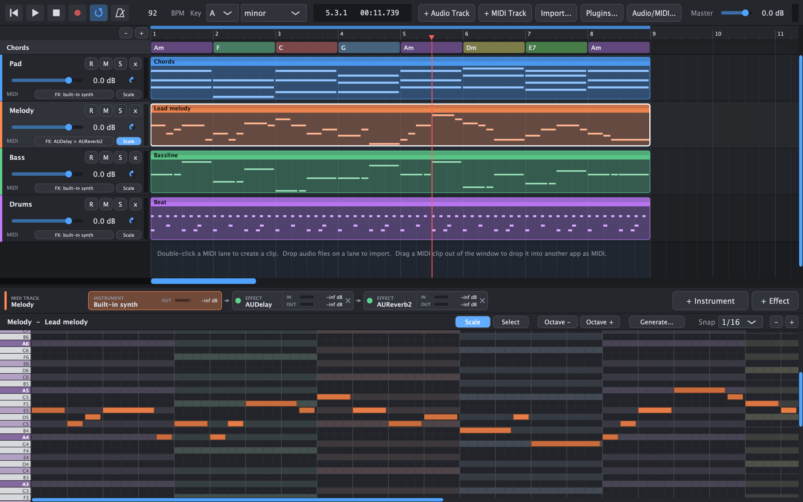
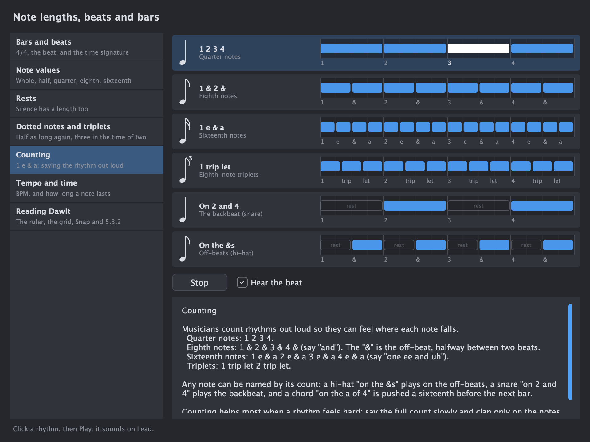

# DawIt - DAW In Theory

**Website: [dawit.studio](https://dawit.studio)**

DawIt (*DAW In Theory*) is a free, open-source desktop music sketchpad that helps you learn while making music. Write and record parts, try out chords and sounds, and explore music theory through playable examples and guides that follow your song.

Built with C++20 and [JUCE](https://juce.com). macOS is the primary target; Windows and Linux build instructions are below.



*The app: arrange parts, try sounds and edit notes in one window.*



*A guide: hear and see how rhythms fit the beat, with explanations beside the example.*

## Features overview

See the [website's features page](website/features.html) for the full catalogue, explanations and screenshots, and [the theory guides](website/learn.html) for what you can learn.

- **Learn as you go:** theory guides with playable examples, live pictures and advice about your own song, plus explanations beside controls.
- **Write and arrange:** audio and MIDI tracks, a piano roll and score view, chords, song sections, lyrics, style templates and playing patterns. Optional local AI helps write musical parts and lyrics.
- **Play and record:** MIDI keyboard or computer-keyboard input, audio and MIDI recording, a metronome and count-in, and chord and lyric displays to play or sing along with.
- **Shape and mix sounds:** built-in instruments and effects, VST3 plugins and Audio Units on macOS, a mixer, buses, sends, returns and a signal-flow view.
- **Explore recordings:** stem separation, audio-to-MIDI conversion, drum-hit, chord and tempo analysis, and English lyrics detection. Models run on your computer.
- **Keep and share your work:** save and reopen projects, export audio and MIDI for other DAWs, and print scores, chord sheets and theory guides as PDFs.

## Optional local AI setup

AI generation uses a separately installed [Ollama](https://ollama.com) server. Install a model, for example:

```bash
ollama pull qwen2.5:7b
```

Keep Ollama running, using its app or `ollama serve`, and choose an installed model in DawIt's Generate panel. The default server address is `http://localhost:11434`; generation runs on your computer. The editor, built-in sounds and theory guides work without Ollama.

## Building

Requirements: CMake ≥ 3.22, a C++20 compiler and Git. JUCE 8.0.9 comes from `external/JUCE` if that folder exists, otherwise CMake downloads it automatically. CMake also downloads demucs.cpp and Eigen at pinned versions (checked by hash) for stem separation. On macOS their matrix maths runs through Apple's Accelerate framework. For audio to MIDI it downloads Microsoft's prebuilt ONNX Runtime 1.30.0 for the platform (macOS on Apple Silicon, Windows x64/ARM64, Linux x64/ARM64), which the build copies into the app (`Contents/Frameworks` on macOS, next to the executable elsewhere), and the Basic Pitch model (230 KB), which is compiled into the app. For detecting lyrics it downloads whisper.cpp 1.9.5 (with ggml) and builds it as static libraries, on Metal and Accelerate on macOS.

### Scripts (macOS / Linux / Git Bash on Windows)

```bash
./build.sh                 # Release build into build/Release
./build.sh debug --test    # Debug build, then run the engine tests
./build.sh --clean         # wipe build/Release and rebuild

./run.sh                   # build if needed, then run (log output in this terminal)
./run.sh debug -- --demo   # run a Debug build with example tracks
./run.sh --no-build        # run the existing build as-is
```

Only one copy of DawIt can run at a time, so quit the running one before using `run.sh`. The sections below show the equivalent plain CMake commands.

### macOS

Requires the Xcode Command Line Tools or Xcode.

```bash
cmake -S . -B build -G Ninja -DCMAKE_BUILD_TYPE=Release
cmake --build build
open build/DawIt_artefacts/Release/DawIt.app
```

To get an Xcode project instead, use `-G Xcode`.

### Windows

Requires Visual Studio 2022 with the "Desktop development with C++" workload.

```bash
cmake -S . -B build -G "Visual Studio 17 2022"
cmake --build build --config Release
```

The app is written to `build/DawIt_artefacts/Release/DawIt.exe`. Plugins are scanned from `C:\Program Files\Common Files\VST3`.

### Linux

Install JUCE's dependencies (Debian/Ubuntu names):

```bash
sudo apt install build-essential cmake ninja-build libasound2-dev libjack-jackd2-dev libfreetype-dev libfontconfig1-dev libx11-dev libxcomposite-dev libxcursor-dev libxext-dev libxinerama-dev libxrandr-dev libxrender-dev libgl1-mesa-dev libcurl4-openssl-dev
```

Then build the same way as on macOS. VST3 plugins are scanned from `~/.vst3` and `/usr/lib/vst3`. Linux needs curl because the AI generator uses HTTP; macOS and Windows use their built-in networking.

## Tests

`DawItTests` is a headless test of the engine. It drives the audio callback through a fake device; what each area checks is listed in [docs/tests.md](docs/tests.md).

Optionally, pass an instrument and an effect to test real plugin hosting. Each is a `.vst3` or `.component` path, or an Audio Unit id such as `AudioUnit:Effects/aufx,rvb2,appl`:

```bash
cmake --build build --target DawItTests
./build/DawItTests_artefacts/Debug/DawItTests /Library/Audio/Plug-Ins/VST3/SomeSynth.vst3 /Library/Audio/Plug-Ins/VST3/SomeEffect.vst3
./build/DawItTests_artefacts/Debug/DawItTests "AudioUnit:Synths/aumu,dls ,appl" "AudioUnit:Effects/aufx,rvb2,appl"
```

The tests also check how model replies become notes: chord building, naming, parsing and the chord track, key mapping, timing, looping and the drum note numbers. These checks need no model. To run one real generation per part type against Ollama, add `--ollama <model>`:

```bash
./build/Debug/DawItTests_artefacts/Debug/DawItTests --ollama qwen2.5:7b
```

The rhythm checks cover naming note values, dotted notes and triplets, splitting other lengths into tied notes, positions and counts, and the guide's topics. The section checks cover tidying overlapping sections, saving and loading them, every structure being whole 4-bar phrases that is explained and recognised, numbering repeated sections, and the advice on a song's own structure. The playing-style checks cover the Generate panel's requests (no model needed for a style played as it is, only chords asked for when bars have none), the prompt and schema, varied patterns with unusable events left out, and scoring a variation above a copy of the style. With `--ollama`, four styles are varied by the real model. The chord style checks play every built-in style over C, Am, F, G and check that it plays only the chords' notes, that each strum runs the right way, that guitar shapes are the usual open shapes (and playable for every chord quality on every root), pushed chords, empty bars, and the walking bass's approach notes.

Audio to MIDI runs the real Basic Pitch model on a synthesized melody and chord, checks that every note is found at its time, and checks the note-finding rules, *One at a time*, quantising and the new track. The C++ port gives the same notes as the basic-pitch Python package on the same audio.

Stem separation is tested without the model too: preparing the input, separating in pieces and cross-fading them back together, cancelling, leaving out silent stems, adding the stem tracks, and putting one stem on its own track. The karaoke checks mix made-up stems back into the mix and into the mix minus the vocals, put the Karaoke and Vocals tracks right below the clip with its position and gain, mute the vocals with the guide off and play them at -12 dB when quiet, make the instrumental as stems, add nothing for a clip without singing, and save and load the new tracks with the project. The sound guide's checks measure left minus right: a sound in the middle cancels, one on a single side keeps its level, a centred bass loses more than 30 dB below 150 Hz, and a mono clip leaves nothing; the engine plays a centred tone as silence while *Hear left minus right* is on. To split a made-up kick-and-bass mix with the real model, add `--demucs <model file>`:

```bash
./build/Release/DawItTests_artefacts/Release/DawItTests --demucs ~/Library/Application\ Support/DawIt/Models/ggml-model-htdemucs-4s-f16.bin
```

To check the lyrics detection with a real Whisper model, add `--whisper <model file>`. On macOS it makes speech with the system's voice (`say`), with a two-second pause in it, and checks the words, where the phrases start and end, and the two lines:

```bash
./build/Release/DawItTests_artefacts/Release/DawItTests --whisper ~/Library/Application\ Support/DawIt/Models/ggml-small.en.bin
```
- Signal flow: the falling levels (into the chain, out of an effect, out of a send) stay when the device bar reads the peaks and fall below 0.001 in a second; the graph of a made-up song (20 boxes, 19 lines and a -12 dB send, the columns and rows, the bypassed box, the lit path of Kick, Vocal and Drums, mute and solo silence, 0.5 shows as -6.02 dB, the example's -9.88 dB and -7.48 dB, and that building the graph changes nothing in the song); a 4:1 compressor's 4.5 dB difference between 6 dB before it and after it; two EQs in either order; the Signal flow topic's text and search words; and the five effect-order advice rules, their buttons, what they leave alone and that moving the compressor removes the advice

To build without tests, pass `-DDAWIT_BUILD_TESTS=OFF`.

The app also has developer flags. `--demo` fills the edit with example tracks. `--screenshots shots.json` takes the screenshots in a list on the example song (an A minor pop song with sections, chords, lyrics, and Drums and Vocals buses): each shot says what to select, open or zoom to (a guide at a topic, a plugin's window, the mixer) and what to capture, and the run uses settings of its own, so it starts the same every time; the format is in `src/ui/DevScreenshots.h`. `--screenshot out.png` renders the window to a PNG and quits. `--export-guides <folder>` saves every guide as a PDF in the folder, then *Start here*, printing the pages, size and time of each, and exits with 1 if an export failed or a guide's topics differ from the Theory Guides list.

## Code layout

How the parts fit together is in [docs/architecture.md](docs/architecture.md), the files each kind of feature touches in [docs/recipes.md](docs/recipes.md), and the UI's look and interaction rules in [docs/ui-design.md](docs/ui-design.md).

The file-by-file list is in [docs/code-layout.md](docs/code-layout.md).

### Threading model

Only the message thread changes the edit (tracks, clips, notes, plugin chains), and it always holds `Engine::getLock()` while doing so. The audio thread only *try-locks* that lock. If the UI happens to hold it, the audio thread outputs one block of silence instead of waiting. Mixer controls and transport state are atomics. Heavy work (file loading, plugin creation and destruction) happens outside the lock.

Positions on the timeline are in beats. Audio clips keep their length in seconds, so their length in beats follows the tempo.

## Known limitations / next steps

- The song timeline currently uses 4/4.
- Plugins are scanned in-process. A plugin that crashes during a scan is skipped on the next scan (dead man's pedal), but it takes the app down that one time.
- Audio clips are fully loaded into RAM (up to 30 minutes per file) and resampled with linear interpolation.

## License note

DawIt is fully open source under the GNU Affero General Public License, version 3 only (`AGPL-3.0-only`). [LICENSE](LICENSE) contains the complete licence and the current component inventory; [licenses/](licenses/README.md) preserves third-party copyright, licence and notice texts with their provenance. JUCE 8.0.9 is used under its AGPLv3 option. The VST3 SDK bundled with it is offered under Steinberg's licence or the GPLv3; DawIt uses it under the GPLv3, which may be combined with AGPLv3 code. (Only VST3 SDK 3.8 and later, bundled from JUCE 8.0.11, is MIT.) The Audio Unit plugins use Apple's AudioUnitSDK (Apache 2.0), which JUCE bundles. The binary notice packaging and complete-source release checks remain in [DISTRIBUTION_TODO.md](DISTRIBUTION_TODO.md).

The score view and its PDF draw clefs, rests, flags and note heads with Bravura (Steinberg, the SMuFL reference font), which is under the SIL Open Font License 1.1. It is downloaded at a pinned commit and a SHA-256 hash when building, embedded in the app, and its licence text is shipped with the app (`Bravura-LICENSE.txt`).

Stem separation uses demucs.cpp (MIT), Eigen (MPL 2.0, built with `EIGEN_MPL2_ONLY`), and the Demucs v4 `htdemucs` weights (MIT), downloaded from the [Retrobear/demucs.cpp](https://huggingface.co/datasets/Retrobear/demucs.cpp) dataset on Hugging Face. Audio to MIDI uses Spotify's Basic Pitch model (Apache 2.0) and ONNX Runtime (MIT), whose library ships inside the app; its `ThirdPartyNotices.txt` lists the components it contains. Detecting lyrics uses whisper.cpp and ggml (MIT) and OpenAI's English Whisper weights `small.en` and `medium.en` (MIT), downloaded from the [ggerganov/whisper.cpp](https://huggingface.co/ggerganov/whisper.cpp) repository on Hugging Face at a fixed revision.

Sing this uses DiffSinger models (openvpi, Apache 2.0; no code is linked, DawIt runs exported ONNX models with ONNX Runtime) and follows OpenUtau (MIT) as its reference for how a voice is laid out and the models are called. The CMU Pronouncing Dictionary (Carnegie Mellon University, `cmudict.dict` at a pinned commit of cmusphinx/cmudict, SHA-256 checked, built into the app, about 3.6 MB) permits redistribution under its BSD-style terms. Its full copyright, conditions and disclaimer are preserved in [licenses/CMUdict-LICENSE.txt](licenses/CMUdict-LICENSE.txt); they must accompany binary distributions, rather than only a one-line acknowledgement. No voice ships with DawIt: the user adds one, and each voice has its own terms, which the Sing window shows (Terms...). The voice DawIt suggests, Hoshino Hanami ~AI❤dol~ for DiffSinger by Lotte V, has a voicebank licence that allows creative and commercial use with credit and forbids redistributing the original audio files; its terms of use also forbid selling the files and political or hateful use. Its vocoder file is licensed CC BY-NC-SA 4.0, as nearly every DiffSinger voice's vocoder is (they derive from OpenVPI's NSF-HiFiGAN). DawIt never redistributes a vocoder or a voice; the user installs them, and the window shows the vocoder's licence. A maintainer of OpenVPI's vocoders wrote on 4 October 2026 that the licence constrains redistributing and modifying the weights, not the data that flows through them; that is a comment, not legal advice, so anyone releasing music commercially should read the terms.
